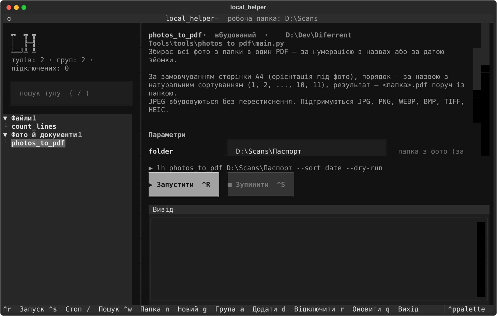

<div align="center">

# 🧰 local_helper

**Особистий набір консольних тулів на Python з одним лаунчером і графічним інтерфейсом прямо в терміналі.**

Написав скрипт — він одразу доступний командою `lh` з будь-якої папки,
з довідкою, формою параметрів і групами. Без реєстрації, без конфігів.




</div>

---

## ✨ Можливості

| | |
|---|---|
| 🔎 **Автоматичний пошук тулів** | Лаунчер при кожному запуску сканує папку `tools/`. Кожна підпапка з `main.py` — це тул, нікуди нічого реєструвати не треба |
| 🖥️ **Інтерфейс у терміналі** | Повноекранний TUI: дерево тулів, пошук, опис, вивід у реальному часі, мишка і гарячі клавіші |
| 📝 **Форма параметрів сама** | Інтерфейс читає `argparse` тулу і будує форму: прапорці — галочки, варіанти — списки, обов'язкові поля позначені |
| 🗂️ **Групи** | Тули розкладаються по групах («Фото», «Файли», …), групи запам'ятовуються і показуються згортальним деревом |
| 🔌 **Тули з будь-якої папки** | `lh add "D:\Scripts\my_tool"` підключає скрипт, що лежить деінде, і CLI запам'ятовує його назавжди |
| ❓ **Довідка для кожного тулу** | `lh <tool> -help` показує, що робить тул і які параметри приймає |
| 🤖 **Дружній до Claude Code** | `CLAUDE.md` описує правила, тож можна просто попросити: «зроби тул, який…» |
| 🛡️ **Безпечно за замовчуванням** | Тули, що змінюють файли, мають `--dry-run` і не перезаписують нічого без `--force` |

---

## 🚀 Швидкий старт

> **Потрібно:** Windows 10/11 і Python 3.10+ з галочкою «Add to PATH».

```powershell
# 1. Клонувати репозиторій
git clone https://github.com/Aleksandr64/local-helper.git "D:\Dev\Diferrent Tools"

# 2. Створити .venv і встановити залежності
python "D:\Dev\Diferrent Tools\local_helper.py" setup

# 3. Додати команди lh і local_helper у PATH (один раз)
powershell -ExecutionPolicy Bypass -File "D:\Dev\Diferrent Tools\install.ps1"
```

Перевідкрий термінал і запусти:

```powershell
lh
```

> [!TIP]
> Команда — `lh` або `local_helper` (з підкресленням). Варіант `localhelper` не працює.

---

## 🖥️ Інтерфейс

`lh` без аргументів відкриває повноекранний інтерфейс:

- **зліва** — дерево тулів по групах і пошук (за назвою, описом і групою);
- **справа** — опис тулу і **форма параметрів**, яка будується з його `argparse`;
- рядок `▶ lh …` показує команду, яка буде виконана; її можна скопіювати;
- **знизу** — вивід тулу в реальному часі, помилки червоним, код виходу.

| Клавіша | Дія |
|:---:|---|
| `↑` `↓` / мишка | вибрати тул · `Enter` — до форми (на групі — згорнути/розгорнути) |
| `Ctrl+R` · `Ctrl+S` | запустити · зупинити тул |
| `/` | пошук |
| `n` | створити новий тул |
| `g` | змінити групу тулу |
| `a` · `d` | підключити тул з іншої папки · відключити підключений |
| `Ctrl+W` | змінити робочу папку |
| `r` | перечитати список тулів |
| `Ctrl+P` | палітра команд (тема, тощо) |
| `q` | вихід |

---

## ⌨️ Команди

| Команда | Що робить |
|---|---|
| `lh` | графічний інтерфейс |
| `lh list [група]` | список тулів по групах |
| `lh <tool> -help` | опис тулу і його параметри |
| `lh <tool> [параметри]` | запустити тул у поточній папці |
| `lh new <name> [--group G] [--description D]` | створити новий тул за шаблоном |
| `lh add <шлях> [--name N] [--group G]` | підключити тул з будь-якої папки |
| `lh remove <tool>` | відключити підключений тул (файли не чіпає) |
| `lh group <tool> <група>` · `lh ungroup <tool>` | покласти тул у групу · прибрати з групи |
| `lh groups` · `groups rename A B` · `groups delete A` | групи: список · перейменувати · видалити |
| `lh setup` | створити `.venv` і встановити всі залежності |

```powershell
lh photos_to_pdf -help
lh photos_to_pdf "D:\Scans\Паспорт" --dry-run
lh group photos_to_pdf "Фото й документи"
lh add . --name my_script --group Утиліти
```

---

## 🧰 Тули

| Тул | Що робить |
|---|---|
| [`photos_to_pdf`](tools/photos_to_pdf/main.py) | Збирає всі фото з папки в один PDF — за нумерацією в назвах або за датою зйомки |
| [`count_lines`](tools/count_lines/main.py) | Рахує файли й рядки в папці з групуванням за розширенням |

<details>
<summary><b>📄 photos_to_pdf — детальніше</b></summary>

<br>

Перетворює папку з фото (сканів документів, чеків, сторінок) в один PDF.

- **Порядок сторінок:** за назвою з натуральним сортуванням (`1, 2, … 10, 11`, а не `1, 10, 11, 2`)
  або `--sort date` — за датою зйомки з EXIF.
- **Без втрати якості:** JPEG вбудовуються в PDF без перестиснення.
- **Формати:** JPG, PNG, WEBP, BMP, TIFF, HEIC (iPhone).
- Фото, повернуті камерою телефону, стоять правильно; прозорі PNG — на білому фоні.
- Сторінки A4 з орієнтацією під фото або `--page original` — сторінка за розміром фото.
- Результат за замовчуванням — `<папка>.pdf` поруч із папкою; існуючий файл не перезаписується без `--force`.

```powershell
lh photos_to_pdf "D:\Scans\Паспорт" --dry-run     # показати порядок сторінок
lh photos_to_pdf "D:\Scans\Паспорт"               # → D:\Scans\Паспорт.pdf
lh photos_to_pdf . --sort date -o trip.pdf --margin 5
```

</details>

<details>
<summary><b>📊 count_lines — детальніше</b></summary>

<br>

Статистика по папці: скільки файлів і рядків кожного типу. Пропускає `.git`, `.venv`, `node_modules`.

```powershell
lh count_lines                       # поточна папка
lh count_lines D:\Projects --ext .py .md
```

</details>

Актуальний список завжди показує `lh list`.

---

## 🛠️ Як додати свій тул

### Попросити Claude Code

Відкрий Claude Code у цій папці й опиши задачу:

> *«Створи тул, який перейменовує фото в папці за датою зйомки, з `--dry-run`, поклади в групу Фото»*

Claude створить `tools/<name>/main.py` за правилами з [`CLAUDE.md`](CLAUDE.md), встановить
залежності, перевірить тул і покладе його в групу. Тул одразу з'явиться в `lh`.

### Вручну

```powershell
lh new rename_photos --group Фото --description "Перейменовує фото за датою зйомки"
```

Далі допиши логіку в `tools/rename_photos/main.py`. Мінімальний контракт:

```python
"""Перейменовує фото за датою зйомки.        ← перший рядок = опис у списку

Приклади:
    local_helper rename_photos D:\\Photos --dry-run
"""
import argparse, sys
from pathlib import Path

def main() -> int:
    parser = argparse.ArgumentParser(prog="local_helper rename_photos", description=__doc__,
                                     formatter_class=argparse.RawDescriptionHelpFormatter)
    parser.add_argument("folder", type=Path, help="папка з фото")      # ← з цього будується форма
    parser.add_argument("--dry-run", action="store_true", help="лише показати")
    args = parser.parse_args()
    ...
    return 0

if __name__ == "__main__":
    sys.exit(main())
```

### Підключити існуючий скрипт

```powershell
lh add "D:\Scripts\video_compress" --group Відео
```

Повні правила, чекліст «тул готовий» і поради — у [**GUIDE.md**](GUIDE.md).

---

## 📁 Структура

```
local-helper/
├── local_helper.py        # лаунчер і всі команди (лише стандартна бібліотека)
├── local_helper_tui.py    # інтерфейс у терміналі (Textual)
├── lh.cmd, local_helper.cmd
├── install.ps1            # додає папку в PATH
├── groups.json            # групи тулів (з'являється після першої групи)
├── tools/
│   ├── photos_to_pdf/
│   └── count_lines/
├── tests/
├── docs/                  # скриншот для README
├── GUIDE.md               # повний посібник
└── CLAUDE.md              # правила для Claude Code
```

`registry.json` (підключені зовнішні тули) і `.venv` створюються локально й у git не потрапляють.

---

## 🔄 Оновлення

`lh` запускається прямо з папки репозиторію, тому оновлення не потребує перевстановлення:

```powershell
git -C "D:\Dev\Diferrent Tools" pull
lh setup        # лише якщо змінились залежності
```

## 🧪 Тести

```powershell
.\.venv\Scripts\python.exe -m unittest discover tests
```

---

<div align="center">

📖 **[Повний посібник — GUIDE.md](GUIDE.md)** · 🤖 **[Правила для Claude — CLAUDE.md](CLAUDE.md)**

</div>
